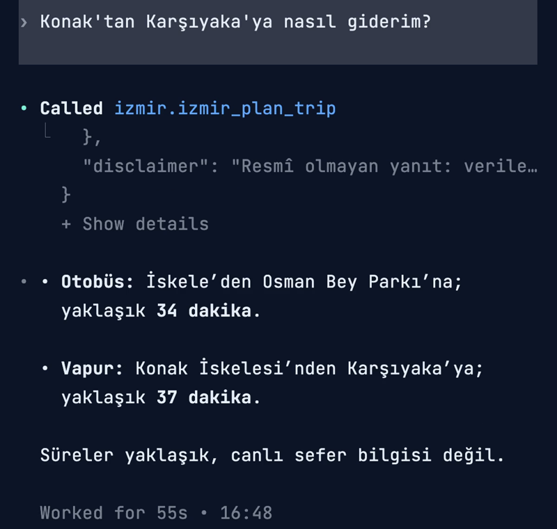
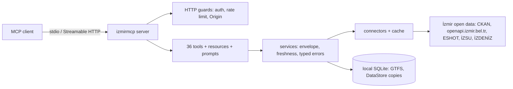

# izmirmcp

<!-- mcp-name: io.github.zexy2/izmir-mcp -->

**A read-only Model Context Protocol server that gives AI agents trustworthy access to İzmir's open city data.**

[](https://github.com/zexy2/izmirmcp/actions/workflows/ci.yml)
[](https://pypi.org/project/izmir-mcp/)
[](LICENSE)
[](pyproject.toml)
[](https://registry.modelcontextprotocol.io/?q=io.github.zexy2/izmir-mcp)
[](docs/tool-reference.md)

<p align="center">
  
</p>

<p align="center"><sub>A real Codex CLI session using the published package (<code>uvx izmir-mcp stdio</code>), recorded 4 November 2026.<br>"How do I get from Konak to Karşıyaka?" → one <code>izmir_plan_trip</code> call → bus ≈34 min, ferry ≈37 min, flagged as estimates rather than live departures.</sub></p>

**Language:** English · [Türkçe](README.tr.md)

## Contents

- [Why izmirmcp](#why-izmirmcp) · [Quick start](#quick-start) · [Tools](#tools) · [Prompts and resources](#prompts-and-resources)
- [Examples](#example-conversations) · [Architecture](#architecture) · [Configuration](#configuration)
- [Data sources](#data-sources-and-disclaimer) · [Security](#security) · [Contributing](#contributing) · [License](#license-and-acknowledgements)

## English

This README is the primary English document; a full Turkish version is in [README.tr.md](README.tr.md).

## Why izmirmcp

- **36 tools** across transit, city services, water, environment and the open-data catalog.
- **One envelope for every answer:** `ok`, `summary`, `data`, `freshness`, `sources`, `limits`,
  `warnings`, `next_queries`, `error`, `result_info` ([contract](docs/response-contract.md)).
- **Honest failures:** an unavailable upstream is a typed error (`source_unavailable`,
  `source_timeout`, `source_rate_limited`), never silently empty data.
- **Hardened HTTP surface:** body caps, rate limits, API keys, Origin allowlist, structured logs.
- **Stable contract:** tool names and schemas only change additively ([policy](docs/tool-migration.md)).

## Quick start

`uvx` (PyPI, from v0.1.0):

```bash
uvx izmir-mcp stdio
```

Docker / GHCR:

```bash
docker run --rm -i ghcr.io/zexy2/izmir-mcp python -m app.stdio      # stdio
docker run -p 8000:8000 -v izmir-data:/data ghcr.io/zexy2/izmir-mcp  # HTTP on /mcp/
```

From source:

```bash
python3.11 -m venv .venv && .venv/bin/pip install -e ".[dev]"
.venv/bin/python -m app.stdio   # or: python -m app.main (Streamable HTTP, http://127.0.0.1:8000/mcp/)
```

Generic stdio config (most clients use this `mcpServers` shape):

```json
{
  "mcpServers": {
    "izmir": { "command": "uvx", "args": ["izmir-mcp", "stdio"] }
  }
}
```

| Client | Config location | Guide |
|---|---|---|
| OpenAI Codex CLI | `~/.codex/config.toml` · `codex mcp add` | [setup](docs/install-clients.md#openai-codex-cli) |
| Claude Code | `claude mcp add` · `.mcp.json` | [setup](docs/install-clients.md#claude-code) |
| Claude Desktop | `claude_desktop_config.json` | [setup](docs/install-clients.md#claude-desktop) |
| Cursor | `~/.cursor/mcp.json` · `.cursor/mcp.json` | [setup](docs/install-clients.md#cursor) |
| VS Code / Copilot | `.vscode/mcp.json` (`servers` key) | [setup](docs/install-clients.md#vs-code--github-copilot) |
| Zed | `settings.json` (`context_servers`) | [setup](docs/install-clients.md#zed) |
| Gemini CLI | `~/.gemini/settings.json` · `gemini mcp add` | [setup](docs/install-clients.md#gemini-cli) |
| Cline | `cline_mcp_settings.json` | [setup](docs/install-clients.md#cline) |

More options: [install guide](docs/install.en.md), [client setup guides](docs/install-clients.md) ([TR](docs/install-clients.tr.md)).

## Tools

Full input/output contracts: [tool reference](docs/tool-reference.md).

### Transit

| Tool | Purpose |
|---|---|
| `izmir_transit_stations` | Metro, İZBAN, İZDENİZ stations and piers |
| `izmir_transit_schedule` | Published metro/İZBAN/İZDENİZ timetables |
| `izmir_tram_lines` | Tram lines |
| `izmir_tram_schedule` | Tram stations and headways for a line |
| `izmir_bus_stops` | Search ESHOT stops by name or location |
| `izmir_bus_arrivals` | Buses approaching a stop (live) |
| `izmir_bus_line_arrivals` | Approaching buses of one line at a stop |
| `izmir_bus_live_positions` | Live bus positions on a line |
| `izmir_bus_departures` | Scheduled GTFS departures (not live ETA) |
| `izmir_bus_routes` | ESHOT route summary and stop sequences |
| `izmir_gtfs_status` | Local GTFS store status and calendar window |
| `izmir_transport_disruptions` | ESHOT, Metro and İZDENİZ notices |
| `izmir_fare` | İZBAN fare between two stations |
| `izmir_plan_trip` | Direct public-transport options between two places |
| `izmir_mobility_nearby` | All transport options near a point |
| `izmir_traffic_history` | Arterial speed/duration history (not live) |
| `izmir_traffic_cameras` | Traffic camera locations (no stream) |
| `izmir_parking_fees` | İZELMAN parking tariffs |

### City services

| Tool | Purpose |
|---|---|
| `izmir_nearby` | Parking, on-duty pharmacies, stations, stops, taxis, chargers nearby |
| `izmir_city_services_nearby` | WiFi, İzmirim Kart top-up points, libraries |
| `izmir_pharmacies_all` | All pharmacies, not only on-duty |
| `izmir_market_schedule` | District market calendar |
| `izmir_market_prices` | Wholesale market prices |
| `izmir_events` | Culture and arts events |
| `izmir_neighborhood_profile` | Neighbourhood population and buildings |
| `izmir_cbs_layer` | Allowlisted İBB GIS layers |

### Water

| Tool | Purpose |
|---|---|
| `izmir_water_status` | İZSU dam levels and outage feed status |
| `izmir_dam_status` | Dam status by date and dam name |
| `izmir_water_production` | İZSU water production snapshot |

### Environment

| Tool | Purpose |
|---|---|
| `izmir_air_quality` | Air-quality measurements by date and station |

### Data & server

| Tool | Purpose |
|---|---|
| `izmir_health` | Local readiness and published limits |
| `izmir_search_datasets` | Search the İzmir Open Data (CKAN) catalog |
| `izmir_get_dataset` | Dataset metadata and resources |
| `izmir_get_resource_schema` | DataStore resource columns |
| `izmir_query_resource` | Filtered DataStore records (no SQL) |
| `izmir_datastore_query` | One safe SELECT over a local copy |

## Prompts and resources

- **Workflow prompts:** `gunun_ozeti`, `veri_kesfi`, `toplu_ulasim`, `otobus`, `pazar_ve_duyurular`, `sehir_hizmetleri`, `nobetci_eczane`, `rota_karsilastir`, `bugun_ne_yapsam`, `su_durumu_raporu`, `eczane_ve_ulasim`, `sehir_simdi`.
- **Resources:** `izmir://coverage`, `izmir://sources`, `izmir://schema/catalog`, `izmir://reference/fares`, `izmir://reference/lines`.

See [MCP interface](docs/mcp-interface.md).

## Example conversations

1. "Konak to Karşıyaka: ferry, metro + İZBAN or bus — which is faster and cheaper?"
2. "Is there a market in Bornova today, and how are air quality and transport notices?"
3. "Any water outage in Buca, and how full are the dams?" (the İZSU outage API sometimes returns 500; the agent sees a typed error)
4. "On-duty pharmacy in Karşıyaka and buses arriving at the nearest stop?"
5. "What is the state of İzmir right now for transport, air and water?"

## Architecture



## Configuration

All settings are `IZMIR_MCP_*` environment variables. Before exposing HTTP publicly, set
`IZMIR_MCP_API_KEYS`, `IZMIR_MCP_REQUIRE_AUTH=true` and `IZMIR_MCP_ALLOWED_HOSTS`.
See [configuration](docs/configuration.md) and [deployment](docs/deployment.md).
Health endpoints: `/healthz`, `/readyz` (never checks upstream), `/status` ([monitoring](docs/monitoring.md)).

## Data sources and disclaimer

Data comes from İzmir Büyükşehir Belediyesi open data (CKAN and `openapi.izmir.bel.tr`), ESHOT,
İZSU, İZBAN, İZDENİZ and İzmir Metro; reference points are © OpenStreetMap contributors (ODbL 1.0).
Status per source: [sources](docs/sources.md), [reachability](docs/source-reachability-analysis.md).
Known gaps (no live traffic index, no İZBAN notice feed, GTFS calendar expiry): [limits](docs/limits.md).

This is an unofficial project. Data may be stale or incomplete; verify critical information
(e.g. pharmacies by phone) with the publishing institution. Public access does not imply a data licence.

## Security

Report vulnerabilities privately: [SECURITY.md](SECURITY.md). Threat model: [docs/security.md](docs/security.md);
scan results: [docs/development/reports/security-report.md](docs/development/reports/security-report.md).

## Contributing

See [CONTRIBUTING.md](CONTRIBUTING.md) and the [Code of Conduct](CODE_OF_CONDUCT.md). Tests run offline:
`.venv/bin/python -m pytest -q` ([development](docs/development.md)).

## Documentation

[Response contract](docs/response-contract.md) · [Tool reference](docs/tool-reference.md) · [MCP interface](docs/mcp-interface.md) · [Deployment](docs/deployment.md) · [Configuration](docs/configuration.md) · [Data sources](docs/sources.md) · [Source reachability](docs/source-reachability-analysis.md) · [Monitoring](docs/monitoring.md) · [Privacy](docs/privacy.md) · [Security / threat model](docs/security.md) · [Security report](docs/development/reports/security-report.md) · [API access](docs/api-access.md) · [Browser and CORS](docs/browser-cors.md) · [Local SQL](docs/datastore-sql.md) · [Place resolution](docs/place-resolution.md) · [GTFS schedule](docs/gtfs-schedule.md) · [Registry](docs/registry.md) · [Tool migration policy](docs/tool-migration.md) · [Development](docs/development.md) · [Limits](docs/limits.md) · [Install (EN)](docs/install.en.md) · [Install (TR)](docs/install.tr.md) · [Launch drafts](docs/launch.md)

## License and acknowledgements

Code is released under the [MIT License](LICENSE).

The architecture, the response envelope and several resilience components are adapted from
[istanbulmcp](https://github.com/Batu1-1an/istanbulmcp) by Kerim Batuhan Baran (MIT).
Some endpoint references follow [IzmirMCP](https://github.com/halilcengel/IzmirMCP) and
[izmir-open-data-py](https://github.com/AtaCanYmc/izmir-open-data-py) (Apache-2.0).
Full notices, including the list of adapted files: [NOTICE](NOTICE).
City data licences belong to the publishing institutions.
