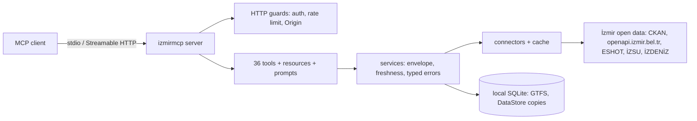

# izmirmcp

**Yapay zekâ ajanlarına İzmir açık şehir verisine güvenilir erişim sağlayan, salt okunur bir Model Context Protocol sunucusu.**

[](https://github.com/zexy2/izmirmcp/actions/workflows/ci.yml)
[](LICENSE)
[](pyproject.toml)
[](https://registry.modelcontextprotocol.io/?q=io.github.zexy2/izmir-mcp)
[](docs/tool-reference.md)

**Dil:** [English](README.md) · Türkçe

## İçindekiler

- [Neden izmirmcp](#neden-izmirmcp) · [Hızlı başlangıç](#hızlı-başlangıç) · [Araçlar](#araçlar) · [Prompt ve kaynaklar](#prompt-ve-kaynaklar)
- [Örnekler](#örnek-konuşmalar) · [Mimari](#mimari) · [Yapılandırma](#yapılandırma)
- [Veri kaynakları](#veri-kaynakları-ve-sorumluluk-reddi) · [Güvenlik](#güvenlik) · [Katkı](#katkı) · [Lisans](#lisans-ve-teşekkür)

## Neden izmirmcp

- Ulaşım, şehir hizmetleri, su, çevre ve açık veri kataloğunda **36 araç**.
- **Her yanıt tek zarf:** `ok`, `summary`, `data`, `freshness`, `sources`, `limits`,
  `warnings`, `next_queries`, `error`, `result_info` ([sözleşme](docs/response-contract.md)).
- **Dürüst hata:** erişilemeyen kaynak tipli hata döner (`source_unavailable`, `source_timeout`,
  `source_rate_limited`); asla sessizce boş veri değil.
- **Sertleştirilmiş HTTP yüzeyi:** gövde tavanı, hız sınırı, API anahtarı, Origin izin listesi, yapısal log.
- **Kararlı sözleşme:** araç adı ve şeması yalnızca eklemeyle değişir ([politika](docs/tool-migration.md)).

## Hızlı başlangıç

`uvx` (PyPI, v0.1.0 ile):

```bash
uvx izmir-mcp stdio
```

Docker / GHCR:

```bash
docker run --rm -i ghcr.io/zexy2/izmir-mcp python -m app.stdio      # stdio
docker run -p 8000:8000 -v izmir-data:/data ghcr.io/zexy2/izmir-mcp  # HTTP, /mcp/
```

Kaynaktan:

```bash
python3.11 -m venv .venv && .venv/bin/pip install -e ".[dev]"
.venv/bin/python -m app.stdio   # veya: python -m app.main (Streamable HTTP, http://127.0.0.1:8000/mcp/)
```

Genel stdio yapılandırması (çoğu istemci bu `mcpServers` biçimini kullanır):

```json
{
  "mcpServers": {
    "izmir": { "command": "uvx", "args": ["izmir-mcp", "stdio"] }
  }
}
```

| İstemci | Yapılandırma yeri | Rehber |
|---|---|---|
| OpenAI Codex CLI | `~/.codex/config.toml` · `codex mcp add` | [kurulum](docs/install-clients.tr.md#openai-codex-cli) |
| Claude Code | `claude mcp add` · `.mcp.json` | [kurulum](docs/install-clients.tr.md#claude-code) |
| Claude Desktop | `claude_desktop_config.json` | [kurulum](docs/install-clients.tr.md#claude-desktop) |
| Cursor | `~/.cursor/mcp.json` · `.cursor/mcp.json` | [kurulum](docs/install-clients.tr.md#cursor) |
| VS Code / Copilot | `.vscode/mcp.json` (`servers` key) | [kurulum](docs/install-clients.tr.md#vs-code--github-copilot) |
| Zed | `settings.json` (`context_servers`) | [kurulum](docs/install-clients.tr.md#zed) |
| Gemini CLI | `~/.gemini/settings.json` · `gemini mcp add` | [kurulum](docs/install-clients.tr.md#gemini-cli) |
| Cline | `cline_mcp_settings.json` | [kurulum](docs/install-clients.tr.md#cline) |

Diğer seçenekler: [kurulum rehberi](docs/install.tr.md), [istemci kurulum rehberleri](docs/install-clients.tr.md).

## Araçlar

Tam girdi/çıktı sözleşmeleri: [araç referansı](docs/tool-reference.md).

### Ulaşım

| Araç | İşlev |
|---|---|
| `izmir_transit_stations` | Metro, İZBAN, İZDENİZ istasyon/iskeleleri |
| `izmir_transit_schedule` | Metro/İZBAN/İZDENİZ tarifeleri |
| `izmir_tram_lines` | Tramvay hatları |
| `izmir_tram_schedule` | Tramvay istasyon ve sefer sıklığı |
| `izmir_bus_stops` | ESHOT duraklarını ada/konuma göre ara |
| `izmir_bus_arrivals` | Durağa yaklaşan otobüsler (canlı) |
| `izmir_bus_line_arrivals` | Bir hattın durağa yaklaşan otobüsleri |
| `izmir_bus_live_positions` | Hattaki otobüslerin canlı konumu |
| `izmir_bus_departures` | GTFS planlı kalkışlar (canlı ETA değil) |
| `izmir_bus_routes` | ESHOT hat özeti ve durak sırası |
| `izmir_gtfs_status` | Yerel GTFS deposu durumu |
| `izmir_transport_disruptions` | ESHOT, Metro, İZDENİZ duyuruları |
| `izmir_fare` | İki İZBAN istasyonu arası ücret |
| `izmir_plan_trip` | İki yer arası doğrudan toplu ulaşım seçenekleri |
| `izmir_mobility_nearby` | Yakınımdaki tüm ulaşım seçenekleri |
| `izmir_traffic_history` | Ana arter hız/süre geçmişi (canlı değil) |
| `izmir_traffic_cameras` | Trafik kamerası konumları (yayın yok) |
| `izmir_parking_fees` | İZELMAN otopark tarifeleri |

### Şehir hizmetleri

| Araç | İşlev |
|---|---|
| `izmir_nearby` | Yakındaki otopark, nöbetçi eczane, istasyon, durak, taksi, şarj |
| `izmir_city_services_nearby` | WiFi, İzmirim Kart dolum noktası, kütüphane |
| `izmir_pharmacies_all` | Tüm eczaneler |
| `izmir_market_schedule` | Semt pazarı takvimi |
| `izmir_market_prices` | Hal fiyatları |
| `izmir_events` | Kültür-sanat etkinlikleri |
| `izmir_neighborhood_profile` | Mahalle nüfusu ve bina sayısı |
| `izmir_cbs_layer` | İzinli İBB CBS katmanları |

### Su

| Araç | İşlev |
|---|---|
| `izmir_water_status` | İZSU baraj doluluğu ve kesinti durumu |
| `izmir_dam_status` | Tarih/baraj adına göre baraj durumu |
| `izmir_water_production` | İZSU su üretimi |

### Çevre

| Araç | İşlev |
|---|---|
| `izmir_air_quality` | Tarih/istasyon bazlı hava kalitesi |

### Veri ve sunucu

| Araç | İşlev |
|---|---|
| `izmir_health` | Yerel hazırlık ve limitler |
| `izmir_search_datasets` | Açık Veri kataloğunda arama |
| `izmir_get_dataset` | Veri seti metadata'sı |
| `izmir_get_resource_schema` | DataStore kolonları |
| `izmir_query_resource` | Filtreli DataStore kayıtları (SQL yok) |
| `izmir_datastore_query` | Yerel kopya üzerinde tek güvenli SELECT |

## Prompt ve kaynaklar

- **İş akışı promptları:** `gunun_ozeti`, `veri_kesfi`, `toplu_ulasim`, `otobus`, `pazar_ve_duyurular`, `sehir_hizmetleri`, `nobetci_eczane`, `rota_karsilastir`, `bugun_ne_yapsam`, `su_durumu_raporu`, `eczane_ve_ulasim`, `sehir_simdi`.
- **Kaynaklar:** `izmir://coverage`, `izmir://sources`, `izmir://schema/catalog`, `izmir://reference/fares`, `izmir://reference/lines`.

Ayrıntı: [MCP arayüzü](docs/mcp-interface.md).

## Örnek konuşmalar

1. "Konak'tan Karşıyaka'ya vapur mu, metro+İZBAN mı, otobüs mü daha hızlı ve ucuz?"
2. "Bornova'da bugün pazar var mı; hava kalitesi ve ulaşım duyuruları nasıl?"
3. "Buca'da su kesintisi var mı, barajlar ne kadar dolu?" (İZSU arıza API'si zaman zaman 500 döner; ajan bunu tipli hata olarak görür)
4. "Karşıyaka'da nöbetçi eczane ve en yakın durağa gelen otobüsler?"
5. "İzmir'de şu an ulaşım, hava ve su açısından durum ne?"

## Mimari



## Yapılandırma

Tüm ayarlar `IZMIR_MCP_*` ortam değişkenleridir. HTTP'yi herkese açmadan önce
`IZMIR_MCP_API_KEYS`, `IZMIR_MCP_REQUIRE_AUTH=true` ve `IZMIR_MCP_ALLOWED_HOSTS` ayarlayın.
Bkz. [yapılandırma](docs/configuration.md) ve [dağıtım](docs/deployment.md).
Sağlık uçları: `/healthz`, `/readyz` (kaynak sağlığı ölçmez), `/status` ([izleme](docs/monitoring.md)).

## Veri kaynakları ve sorumluluk reddi

Veriler İzmir Büyükşehir Belediyesi açık verisi (CKAN ve `openapi.izmir.bel.tr`), ESHOT, İZSU,
İZBAN, İZDENİZ ve İzmir Metro'dan gelir; referans noktaları © OpenStreetMap katkıcıları (ODbL 1.0).
Kaynak bazında durum: [kaynaklar](docs/sources.md), [erişilebilirlik](docs/source-reachability-analysis.md).
Bilinen boşluklar (canlı trafik indeksi yok, İZBAN duyuru akışı yok, GTFS takvim bitişi): [sınırlar](docs/limits.md).

Bu resmî olmayan bir projedir. Veriler eski veya eksik olabilir; kritik bilgiyi (ör. eczaneyi telefonla)
yayıncı kurumdan teyit edin. Açık erişim, veri lisansı izni anlamına gelmez.

## Güvenlik

Güvenlik açıklarını gizli bildirin: [SECURITY.md](SECURITY.md). Tehdit modeli: [docs/security.md](docs/security.md);
tarama sonuçları: [docs/development/reports/security-report.md](docs/development/reports/security-report.md).

## Katkı

[CONTRIBUTING.md](CONTRIBUTING.md) ve [Davranış Kuralları](CODE_OF_CONDUCT.md). Testler ağsız çalışır:
`.venv/bin/python -m pytest -q` ([geliştirme](docs/development.md)).

## Dokümantasyon

[Yanıt sözleşmesi](docs/response-contract.md) · [Araç referansı](docs/tool-reference.md) · [MCP arayüzü](docs/mcp-interface.md) · [Dağıtım](docs/deployment.md) · [Yapılandırma](docs/configuration.md) · [Veri kaynakları](docs/sources.md) · [Kaynak erişilebilirliği](docs/source-reachability-analysis.md) · [İzleme](docs/monitoring.md) · [Gizlilik](docs/privacy.md) · [Güvenlik / tehdit modeli](docs/security.md) · [Güvenlik raporu](docs/development/reports/security-report.md) · [API erişimi](docs/api-access.md) · [Tarayıcı ve CORS](docs/browser-cors.md) · [Yerel SQL](docs/datastore-sql.md) · [Yer çözümleme](docs/place-resolution.md) · [GTFS tarifesi](docs/gtfs-schedule.md) · [Registry](docs/registry.md) · [Araç geçiş politikası](docs/tool-migration.md) · [Geliştirme](docs/development.md) · [Sınırlar](docs/limits.md) · [Kurulum (EN)](docs/install.en.md) · [Kurulum (TR)](docs/install.tr.md) · [Duyuru taslakları](docs/launch.md)

## Lisans ve teşekkür

Kod [MIT lisansı](LICENSE) ile yayımlanır.

Mimari, yanıt zarfı ve bazı dayanıklılık bileşenleri Kerim Batuhan Baran'ın
[istanbulmcp](https://github.com/Batu1-1an/istanbulmcp) projesinden (MIT) uyarlanmıştır.
Bazı uç noktası referansları [IzmirMCP](https://github.com/halilcengel/IzmirMCP) ve
[izmir-open-data-py](https://github.com/AtaCanYmc/izmir-open-data-py) (Apache-2.0) projelerine dayanır.
Uyarlanan dosyaların listesi dahil tüm bildirimler: [NOTICE](NOTICE).
Şehir verilerinin lisansları yayıncı kurumlara aittir.
